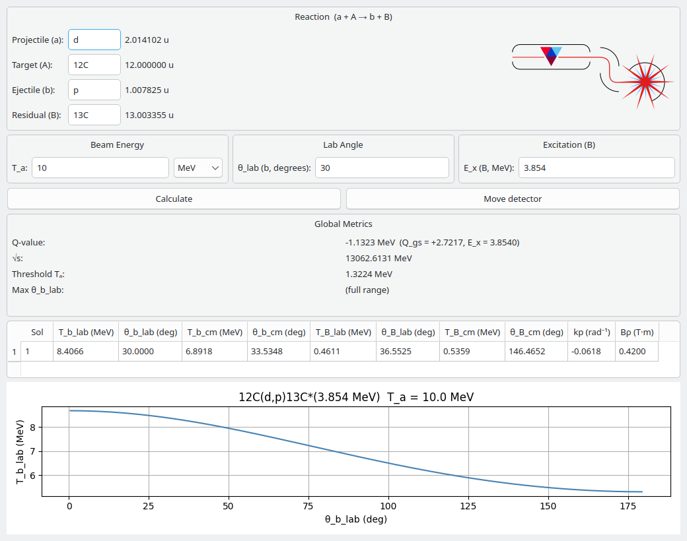

# Nuclear Kinematics

A desktop calculator for relativistic two-body nuclear reaction kinematics, `A(a,b)B`, using AME2020 atomic masses.



## Features

- Enter nuclides in any common form: `p`, `d`, `t`, `a`, `12C`, `C12`, `208Pb`. The residual nucleus fills in automatically.
- Beam energy in MeV or MeV/u.
- Residual nucleus can be left in an excited state (E_x).
- Global quantities: Q-value, √s, threshold energy for endothermic reactions, and the maximum ejectile lab angle (for inverse kinematics).
- At a chosen lab angle, every kinematic solution for the ejectile and residual: lab and CM energies and angles, kinematic compression factor *k* = (1/ρ)(dρ/dθ) (used to set up magnetic spectrographs), and magnetic rigidity Bρ.
- A plot of ejectile energy against lab angle (the kinematic locus).

All calculations are fully relativistic. Masses are atomic masses from AME2020, bundled with the package, so no internet connection is needed.

## Installation

You need Python 3.9 or newer.

Install with [pipx](https://pipx.pypa.io/) (recommended, as it keeps the app in its own environment):

```bash
pipx install git+https://github.com/TUNL-Enge/RelKin.git
```

or with pip:

```bash
pip install git+https://github.com/TUNL-Enge/RelKin.git
```

Then start the app:

```bash
nuclear-kinematics
```

## Development

```bash
git clone https://github.com/TUNL-Enge/RelKin.git
cd RelKin
python3 -m venv .venv
.venv/bin/pip install -e . pytest
.venv/bin/python -m pytest          # run the tests
./nuclear-kinematics.sh             # run the app from the checkout
```

The physics is in `nuclear_kinematics/core/` (masses, kinematics, Rutherford scattering) and is independent of the GUI in `nuclear_kinematics/gui/`.

## Mass data

Masses come from the 2020 Atomic Mass Evaluation:

> M. Wang, W. J. Huang, F. G. Kondev, G. Audi and S. Naimi, *The AME 2020 atomic mass evaluation (II). Tables, graphs and references*, Chinese Physics C **45**, 030003 (2021).

The table in `nuclear_kinematics/data/ame2020_mass_excess.csv` was extracted with the [nuclearmasses](https://github.com/php1ic/nuclearmasses) package (MIT licence).

## License

MIT. See [LICENSE](LICENSE).
